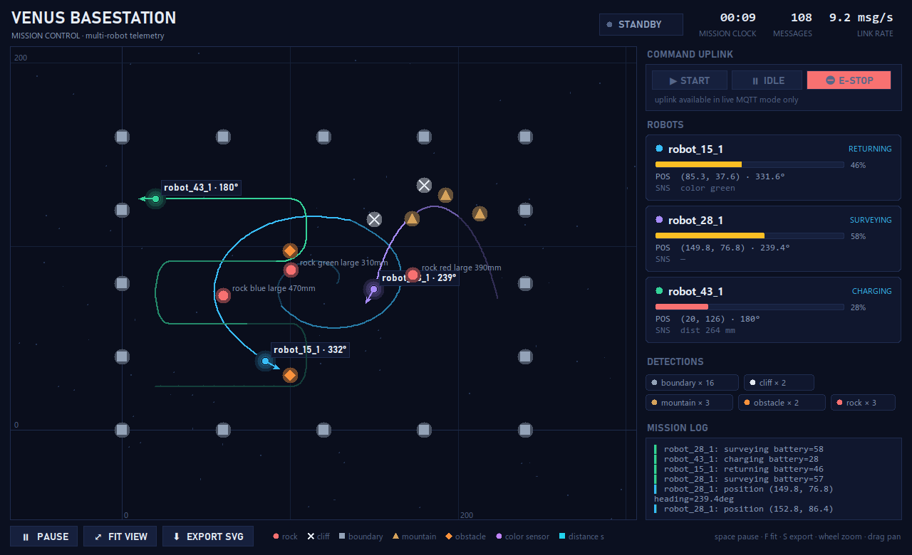

# Venus Basestation

The base station I wrote for my TU/e team's Venus exploration robots: it reads the robots' telemetry
over MQTT (or from a recorded JSONL file), keeps a map of where each robot drove and what it found,
and shows it in a Tk mission-control dashboard that can also send start / idle / stop commands back
to a robot.



*The Tk dashboard replaying `examples/demo_mission.jsonl`, a generated three-robot mission (not
real robot data). Captured from the running app on a virtual X display.*

## What I built

My part of the team project is `user-interface-module/` (about 2.5k lines of Python plus 109 tests):

- **Message parsing** (`message_schema.py`): turns robot JSON into observations (position, rock,
  cliff, boundary, mountain, obstacle, status, colour/distance sensor). It accepts the field names
  the team's communication module actually sends (`type=position_update`, `rock_detected`,
  `object_distance_mm`, ...) and payloads that still carry the 4-byte UART length prefix, and rejects
  NaN/infinite coordinates.
- **Map state** (`map_state.py`): tracks, latest status and detected objects per robot; exports JSON.
- **Tk dashboard** (`tk_dashboard.py`): map with zoom/pan, robot cards, detection counts, mission
  log, SVG export. In live mode the MQTT client runs on background threads and only queues events;
  the Tk thread drains the queue, so widgets are never touched from another thread.
- **MQTT client** (`mqtt_client.py`): one connection per robot account (the course broker ties each
  login to one board), topic names derived from the username, readable errors for a wrong password
  or an ACL rejection.
- **Command uplink**: START / IDLE / E-STOP buttons publish `{"command": ..., "arguments": [...]}`
  to `/pynqbridge/<board>/recv` with QoS 1.
- **Tools**: JSONL replay and generators, and `tools/uart_mqtt_bridge.py`, a fallback that runs on
  the PYNQ, reads the firmware's framed JSON from the serial port and republishes it to MQTT.

## Try it without a robot

Python 3.10+; Tk is part of the standard Windows/macOS installers (`python3-tk` on Debian/Ubuntu).

```bash
cd user-interface-module
python -m venv .venv
source .venv/bin/activate            # Windows: .venv\Scripts\Activate.ps1
pip install -e .

# open the dashboard on the recorded demo mission (the screenshot above)
python -m venus_basestation --source jsonl --jsonl-path examples/demo_mission.jsonl

# or on a simulated live stream
python -m venus_basestation --source simulated
```

Without a window:

```text
$ python -m venus_basestation --source jsonl --jsonl-path examples/demo_mission.jsonl --headless --save-state outputs/state.json --save-figure outputs/mission.svg
processed 108 messages
wrote state summary to outputs/state.json
wrote svg snapshot to outputs/mission.svg
```

PNG export (`--save-figure x.png`) needs matplotlib: `pip install -e ".[dashboard]"`.

## Connect to the robots

1. Copy `user-interface-module/.env.example` to `.env` and fill in `VENUS_MQTT_USERNAME`
   (for example `robot_43_1`) and `VENUS_MQTT_PASSWORD`. The `.env` file is git-ignored.
2. Run `python -m venus_basestation` (or `.\run-dashboard.ps1` on Windows). With
   credentials set it connects to `mqtt.ics.ele.tue.nl` and subscribes to `/pynqbridge/43/send`
   (plus the older `/pynqbridge/robot_43_1/send` form). Without credentials it says so and falls
   back to simulated data.
3. For two robots at once set `VENUS_MQTT_ACCOUNTS=robot_43_1:<pw>,robot_15_1:<pw>`; robots are
   then labelled by board (`43:A`, `15:A`).

Useful checks:

```bash
python -m venus_basestation --mqtt-check --mqtt-min-messages 0   # login + subscribe only, no window
python -m venus_basestation --source mqtt --send-command idle     # one command, then exit
```

`python -m venus_basestation --help` lists all options. The accepted message fields are in
[`docs/message-format.md`](user-interface-module/docs/message-format.md) and the team's topic
conventions in [`docs/team28-current-interface.md`](user-interface-module/docs/team28-current-interface.md).

## Tests

```bash
cd user-interface-module
pip install -e ".[dev,dashboard]"
python -m pytest -q        # 109 passed on Windows, Python 3.12
```

The Tk window tests skip themselves when there is no display. GitHub Actions runs everything on
Python 3.10 and 3.12 under Xvfb and replays the demo mission headless.

## Limits

- I tested the live path against the course broker with my own test publishes in the team's
  message format. I have not seen a full run with real robot telemetry: the robot firmware writes
  its JSON over UART, and something (the course's ESP32 relay or `tools/uart_mqtt_bridge.py`) has
  to forward it to MQTT.
- Coordinates are drawn as received; units, origin and heading convention are whatever the robots
  send.
- A command button only confirms that the broker accepted the publish, not that the robot acted on it.

## What else is in this repository

`team-project/` is a copy of the team's GitLab repository, kept so the UI module can be read in
context: the PYNQ course library `libpynq-5EID0-2023-v0.3.0/` (course material with its own
license) and snapshots of my teammates' module branches (embedded software, communication,
navigation, mapping). I did not write that code. See [`team-project/PROVENANCE.md`](team-project/PROVENANCE.md).

## License

MIT for `user-interface-module/` only; see [LICENSE](LICENSE) for the scope.
